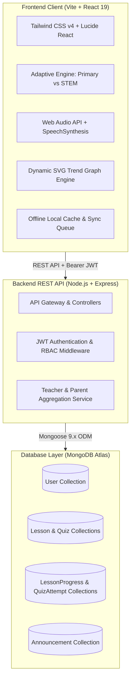

# 🌾 RuralConnect

### Adaptive Learning Engine & 3-Way Stakeholder Bridge for Rural Classrooms

  <b>Bridging the village digital divide through offline resilience, dual-band adaptive UI, and a frictionless 3-way code connection system.</b>

[Explore Features](#-key-features) • [System Architecture](#-system-architecture) • [Tech Stack](#-tech-stack) • [Quickstart](#-getting-started) • [API Contracts](#-rest-api-reference)

---

## 📌 Problem Statement

Rural education across emerging regions faces three critical bottlenecks:
1. **Unreliable Internet & Power:** Cloud-only apps fail completely during frequent village network outages.
2. **Age & Literacy Disparity:** Standard educational portals alienate 7-year-olds with clinical dashboards or bore 15-year-olds with childlike interfaces.
3. **Parental Disconnect & Teacher Burden:** Parents with low digital literacy lack visibility into their children's daily learning, while multi-grade teachers struggle with paper assessments and lack tools to track progress.

**RuralConnect** solves this by combining offline-first edge architecture, a dual-band interface that transforms dynamically by grade level, and a zero-friction code system connecting teachers, students, and parents.

---

## 🚀 Key Features

### 🔐 1. 3-Way Code Linking (Zero Email / Phone Requirement for Kids)
* **Class Codes:** Teachers generate 6-character classroom codes (e.g., `L4N3Z6`) that students use to enroll into specific grades and subjects.
* **Unique Parent Codes:** Every student automatically receives an alphanumeric parent code (e.g., `J69QMA`). Parents simply enter this code to instantly link to their child's live profile without requiring passwords, emails, or student IDs.

### 🎨 2. Dual-Band Adaptive UI Engine
The entire client transforms based on the selected standard:
* **Primary Wonder World (Classes 1–5):** Sunny playful theme, cartoon animal learning buddies, Chintu mascot audio synthesis, and interactive gamified slide decks.
* **Secondary STEM Hub (Classes 6–10):** Dark futuristic STEM workbench, circuit diagrams, physics laboratory modules, and distraction-free layouts.

### 👩‍🏫 3. Teacher Classroom Console
* **Assigned Classrooms Only:** Teachers only see the specific classes and standards they teach.
* **Student Activity Tracker:** Detailed breakdown of registered students, completed lectures, attendance streaks, and quiz attempts.
* **Study Material & Practical Creator:** Author lectures with slide decks and village-contextual hands-on experiments (e.g., clay pot evaporation, courtyard shadow clocks, paper chapati fractions).
* **Test Builder & Evaluator:** Create objective quizzes, review student attempts, grade answers, and write personalized remarks.

### 👨‍👩‍👧 4. Parent Portal with SVG Trend Graphs
* **Personalized Greeting:** Greeted with *"Welcome, Parent of [Child Name]! 🎉"*.
* **Dynamic SVG Performance Graph:** Vector line and area chart plotting test marks and percentage trends over time against a 75% target benchmark.
* **Voice Read-Aloud (`🔊 Listen in Voice`):** Native Web Speech API synthesis reads complete student progress aloud for parents with lower literacy levels.
* **Activity & Marks Breakdown:** Complete logs of completed experiments, quiz marks, and teacher remarks.

### ⚡ 5. Offline-First Resilience
* Built-in local caching and sync queue. Students can complete lessons and take quizzes during network dropouts; submissions queue locally and sync with idempotent deduplication once the village hub reconnects.

---

## 🏗️ System Architecture

### 🔁 The 3-Way Code Flow
